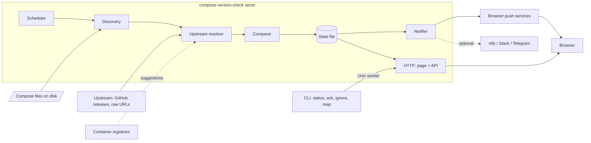

# compose-version-check: revival design

Status: draft, 2026-11-11

## Summary

compose-version-check tells self-hosters when the upstream maintainer of a stack changes the image versions in their own compose file, for example when Immich moves its Postgres image or Paperless bumps Redis. It answers "what does the maintainer recommend now?", which registry-based tools (Diun, What's Up Docker, Renovate) don't: they answer "what is the newest tag?".

The revival turns a one-shot script into a small service:

- **Today:** one ~450-line Go file. A config maps each local compose file to an upstream URL; it compares `image:` lines as strings and posts differences to Slack, ntfy or Telegram. Ofelia runs it on a schedule inside Docker.
- **Revived:** one Go binary with a long-running `serve` mode (scheduled checks, a small web page, browser push notifications, a local API) and CLI commands that query it. It reads compose files only and never edits them.

## Goals and non-goals

**Goals**

- Notify without setup: browser push from the tool's own page, so users don't need ntfy, Slack or Telegram.
- Show the latest results on a simple HTML page and through `status` on the command line.
- Alert once per upstream change, not on every run.
- Make mapping a compose file to its upstream as close to zero effort as possible.
- Run as a single static binary under systemd (amd64 and arm64), with a Docker image as an option.

**Non-goals**

- Editing compose files or restarting containers. Major database bumps need migrations, and upstream changes often come in groups (a new image plus a new env var), so a human applies them.
- Tracking the newest registry tags. Diun and What's Up Docker already do that.
- Comparing anything other than images in v1: new env vars, volumes and ports are out of scope for now.
- History of past checks, accounts, multi-user support or a database server.

## Architecture



- **Discovery** finds compose files under the configured folders and reads their `x-upstream` blocks.
- **Upstream resolver** decides which upstream file belongs to each stack (see [Mapping](#mapping-compose-files-to-upstream)) and fetches it.
- **Comparer** resolves variables on both sides and produces a list of changes per stack.
- **State file** holds results, alerts, saved mappings and push subscriptions. It is the only state.
- **Notifier** sends each new alert once, through Web Push and any optional channels.
- **HTTP** serves the page (embedded in the binary with `go:embed`, no build step) and the JSON API the page and the CLI use.

## Commands

One binary, several subcommands. The service owns the state; other commands talk to it through its API over a Unix socket (`/run/compose-version-check/api.sock`), so there is one source of truth. Access to the socket is controlled by file permissions, so the CLI needs no login.

| Command | What it does | Needs the service running |
| --- | --- | --- |
| `serve` | Scheduled checks, web page, Web Push, local API | n/a |
| `check` | Runs one check now and prints the results; exits non-zero on changes (usable in scripts) | No |
| `status` | Prints the latest results and open alerts | Yes |
| `ack <stack>` | Marks the current upstream changes for a stack as seen | Yes |
| `ignore <stack>/<service>` | Stops alerting for one service (for example, a deliberately different image) | Yes |
| `map <stack> <url>` | Saves an upstream link for a stack without editing its compose file | Yes |
| `hash-password` | Prints a bcrypt hash of a password, for the login setting in the config | No |

The check interval is a flag on `serve` (`--interval 6h`), which replaces Ofelia.

## Mapping compose files to upstream

### Finding compose files

`serve` and `check` scan the configured folders for `compose.yaml`, `compose.yml`, `docker-compose.yaml` and `docker-compose.yml`, a few levels deep. A stack is named after its compose project name (the top-level `name:`), or its folder name if there is none.

Optionally, the tool can read the `com.docker.compose.project.config_files` label from running containers to find compose files outside those folders. That needs the Docker socket, which is close to root access, so it is off by default.

### Which upstream belongs to a stack

The first source that has an answer wins:

1. **`x-upstream` in the compose file.** Compose ignores top-level keys starting with `x-`, so this is safe to add:

   ```yaml
   x-upstream:
     url: https://github.com/immich-app/immich/releases/latest/download/docker-compose.yml
     env: https://github.com/immich-app/immich/releases/latest/download/example.env  # optional
     ignore: [immich-machine-learning]                                              # optional
   ```

2. **A saved mapping** in the tool's state, created with `map` or by confirming a suggestion on the page. The compose file is not touched.
3. **The built-in catalog**: a YAML file embedded in the binary that lists where popular stacks (Immich, Paperless-ngx, Authentik, Nextcloud, ...) publish their compose files, matched by image name. Contributions are PRs to that file.
4. **A suggestion**, shown on the page but not used until confirmed (below).

### Suggestions

For an unmapped stack:

1. For each image, read the image config from its registry and take the `org.opencontainers.image.source` label, which many images set to their GitHub repo. No Docker socket is needed.
2. In that repo, look for a compose file in the latest release's assets first, then at the usual paths on the default branch: `docker-compose.yml`, `compose.yaml`, `docker/docker-compose.yml`, `docker/compose.yaml`.
3. Keep a candidate only if it parses and contains a service using the same image repository.
4. Show it on the page with a **Confirm** button, which saves it as a mapping.

Unauthenticated GitHub API calls are limited to 60 per hour, so suggestions are cached, and an optional GitHub token raises the limit. Downloading files through `releases/latest/download/...` and `raw.githubusercontent.com` doesn't use the API.

## Comparison rules

**Fetching**

- Any non-2xx response is an error. (Today a GitHub 404 page parses as valid YAML with no services and reports "no changes".)
- The body must parse as YAML and have a `services` key.
- Requests have a timeout and a size limit, and use `ETag` / `If-None-Match` so unchanged files cost little.

**Variables**

- Resolve `${VAR}`, `${VAR:-default}` and `${VAR-default}` in image values.
- Upstream side: values come from the upstream `.env` (`x-upstream.env`) if given, otherwise the defaults in the expression.
- Local side: values come from the `.env` next to the local compose file, then the defaults.
- If a value can't be resolved, compare the raw strings and mark the result "unresolved" instead of guessing.

**Image references**

- Parse into registry, repository, tag and digest. The first part is a registry only if it contains `.` or `:` or is `localhost`; the default is `docker.io/library`, and a missing tag means `latest`. This fixes the current bug with `registry:5000/foo`.
- A change in the digest alone is reported as a minor change, since it means the maintainer re-pinned the image.

**Matching services**

- Match local and upstream services by name first, then by image repository, so a service renamed locally still matches.
- An upstream service with no local match is reported as "new upstream service". A local service with no upstream match is shown as "local only" with no alert.

**Kinds of change**

| Kind | Example | Alert |
| --- | --- | --- |
| Tag change | `redis:7.2` to `redis:7.4` | Yes |
| Major version change | `postgres:15` to `postgres:16` | Yes, marked "may need a migration" |
| Image swap | `tensorchord/pgvecto-rs` to `ghcr.io/immich-app/postgres` | Yes, marked |
| New upstream service | upstream adds `valkey` | Yes |
| Digest only | same tag, new `@sha256:` | Minor |

**Release vs. branch.** A compose file on `main` can describe images for a version that isn't released yet. The README recommends release URLs, and suggestions prefer release assets.

## State and alert lifecycle

State is one JSON file in the service's state folder (`/var/lib/compose-version-check/state.json` under systemd), written atomically (write to a temp file, then rename). There is no history: it holds only what the service needs right now.

It stores:

- Per stack: the last check time, the last error, the resolved upstream images and the current changes. This is a cache; deleting it only means the next check rebuilds it.
- Alert states: which alerts were notified, acknowledged or ignored. This is the part that matters, since it stops repeat notifications.
- Saved mappings (from `map` or confirmed suggestions).
- Web Push subscriptions and the VAPID keys.

An alert is identified by **stack + service + the upstream value**. That gives this lifecycle:

- **New:** the comparer finds a difference that has no alert yet. The notifier sends it once and marks it **notified**.
- **Acknowledged:** `ack` or the page button. No more notifications for that value.
- **Ignored:** `ignore` silences a service until the user removes the ignore.
- **Resolved:** the local file now matches upstream. The alert closes on its own.
- If upstream changes again (a new value), that is a new alert, even if the old one was acknowledged.

Errors (fetch failures, parse errors) alert only after 3 failures in a row, and only once, so a short GitHub outage doesn't send notifications.

## Notifications

**The page.** One HTML page with plain JavaScript, served by the binary. It shows a table of stacks: status, changes (old to new), last checked, and buttons to acknowledge, ignore and confirm suggestions. It refreshes by polling the API (or server-sent events later).

**Web Push.** The page registers a service worker and subscribes with the server's public key. The server stores subscriptions in the state file and sends notifications with [`webpush-go`](https://github.com/SherClockHolmes/webpush-go) through the browser vendor's push service. The keys (VAPID) are generated on first start and saved.

Requirements and limits, which the README must state:

- Browsers allow Web Push only on **HTTPS** or `localhost`. A plain `http://server:8080` can show the page but can't subscribe. The intended setup is behind a reverse proxy with TLS (Caddy, Traefik, nginx).
- On iPhone and iPad, Web Push works only after the page is added to the home screen (iOS 16.4 or later).
- Subscriptions expire. A `404` or `410` from the push service removes the subscription.

A notification says what changed and links to the page, for example: `immich: database postgres 14 → 16 (major, may need a migration)`.

**Optional channels.** The existing ntfy, Slack and Telegram code stays as optional channels in the config, for people who already use them or can't use HTTPS.

## Deployment and security

- **Releases:** GitHub Actions with GoReleaser builds static Linux binaries for amd64 and arm64 (plus macOS and Windows, which are handy for `check`).
- **systemd:** a unit file that runs as a dedicated user with read access to the stack folders, with `ProtectSystem=strict`, read-only access to the stack folders, and `StateDirectory=compose-version-check`.
- **install.sh:** fixed to install the binary, the unit file and an example config that actually exists in the repo.
- **Docker image:** `mcanyucel/compose-version-check`, on a distroless/static base pinned by digest, with stack folders mounted read-only and no Docker socket by default.
- **Network:** the web page listens on `127.0.0.1` by default. To reach it from elsewhere, put it behind a reverse proxy with TLS. The page lists every stack you run, so it shouldn't be reachable without a login.
- **Login:** built in, because not everyone has SSO and Caddy's basic auth prompt is unpleasant to use.
  - One password, stored as a bcrypt hash in the config (`compose-version-check hash-password` prints one).
  - A login form sets a signed session cookie with `HttpOnly`, `Secure` and `SameSite=Strict`. `SameSite=Strict` plus an `Origin` check on POST requests covers cross-site request forgery.
  - Failed logins are rate limited.
  - `auth: none` turns it off explicitly, for setups behind SSO (Authelia, Authentik).
  - Requests from localhost are **not** exempt: behind a reverse proxy every request comes from localhost, so an exemption would quietly disable the login. The CLI uses the Unix socket instead.
  - Receiving push notifications needs no login; subscribing to them does.
- **Outbound traffic:** GitHub (or other upstream hosts), container registries (suggestions only), browser push services, optional channels.
- **Config:** `/etc/compose-version-check/config.yaml` with the folders to scan, interval, listen address, optional channels and an optional GitHub token.

## Milestones

1. **Correct comparisons.** HTTP status checks, image reference parsing, variable and `.env` resolution, service matching, change kinds. Tests with fixtures from real stacks (Immich, Paperless-ngx). Bump `go.mod` from Go 1.19.
2. **Discovery and `check`.** Folder scanning, `x-upstream`, the new config file (the old `files:` format is dropped), `check` command.
3. **The service.** State file, alert lifecycle, `serve --interval`, API on the Unix socket, `status` / `ack` / `ignore` / `map`.
4. **Page, login and Web Push.** Embedded page, built-in login, service worker, push subscriptions, optional channels moved onto the new notifier.
5. **Packaging.** GoReleaser, systemd unit, install.sh, Docker image, README rewrite.
6. **Mapping help.** Suggestions from image labels, built-in catalog.

## Decisions

| Question | Decision |
| --- | --- |
| Scope of v1 | Images only |
| State storage | One JSON file, no history |
| Auth | Built-in single-password login, `auth: none` to opt out; CLI over a Unix socket |
| Old config format | Dropped |
| Name | `compose-version-check` everywhere: repo, binary, Docker image (`mcanyucel/compose-version-check`) and display name. The old `mcanyucel/compose-checker` image gets a deprecation note pointing to the new one, and the personal site's project page drops "Docker" from its title. |
| Upstreams per compose file | One. A compose file is one app's stack and follows one upstream file; every service in it is compared. Per-service `x-upstream` can be added later if someone needs it. |

## Open questions

None at the moment.
